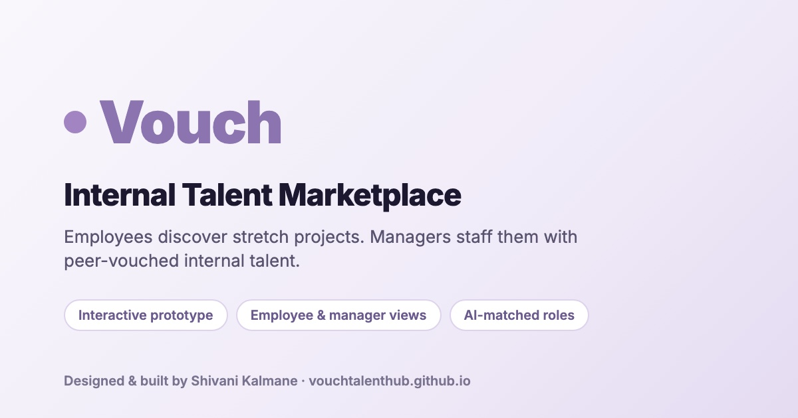

# Vouch — Internal Talent Marketplace

**Live demo → [vouchtalenthub.github.io](https://vouchtalenthub.github.io)**

Vouch is a clickable prototype for internal mobility. Employees discover cross-functional projects and apply with context. Managers staff those projects with internal talent whose skills have already been vouched for by their own managers.

## Try it
Open the live demo and sign in as either persona (no password needed):
- **Employee:** browse listings, see AI-matched roles, apply with your available bandwidth, track application status, and review past managers.
- **Manager:** create listings, review applicants with vouched skills and cross-functional ratings, accept or reject, and set development goals for your team.

Decisions are shared between the two views, so a manager's accept/reject shows up immediately in the employee's *My Applications*. Dark mode is available from the top bar.

## Why
Internal mobility is broken at most companies. Employees with capacity and ambition can't see cross-functional opportunities, and managers can't easily find vetted internal talent, so they hire externally instead. Vouch makes internal moves a first-class workflow built on peer-validated trust signals.

## Built with
Plain HTML, CSS and JavaScript in a single file (`index.html`). No framework, no build step, no backend; all data is mocked in the browser.

---
Designed and built by **Shivani Kalmane**.
